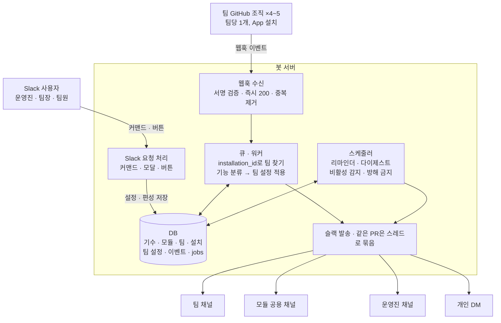

# 부트캠프 GitHub–Slack 알림 봇 설계서

기준일: 2026-11-19

## 1. 개요

팀별 GitHub 조직에서 일어나는 PR·브랜치·리뷰 이벤트를 팀 슬랙 채널과 운영진 채널로 자동 알림하고, 팀이 고른 브랜치 전략을 룰셋으로 강제하며, 그래도 생긴 위반은 사후 감지하는 봇이다. 팀장은 알림과 브랜치 전략을 슬랙 안에서 직접 설정한다.

운영 전제:

- 인원은 기수당 약 20명, 팀은 4~5인으로 모듈당 4~5개 팀이 생긴다.
- 모듈 단위로 팀 프로젝트가 시작·종료되며, 모듈마다 팀이 재편성된다.
- 각 팀이 자기 GitHub 조직을 직접 만든다. 즉 **조직 1개 = 팀 1개**이며, 운영진이 조직을 소유하지 않는다.
- 리포는 공개가 기본이다. 리포 이름은 팀이 자유롭게 정하며, 이름 규칙에 의존하는 설계는 하지 않는다.
- 사람(GitHub–슬랙 계정 연결)은 기수 내내 고정, 팀·조직·채널 매핑은 모듈마다 교체된다.

## 2. 전체 아키텍처

봇 서버 하나가 GitHub 웹훅과 Slack 요청을 모두 받고, 설치 ID로 팀을 찾아 팀 설정에 따라 발송한다.

구성 요소는 GitHub App(각 팀 조직에 설치), Slack App(워크스페이스에 1회 설치), 봇 서버(웹 서버 + 큐 워커 + 스케줄러), DB 네 가지다. 20명 규모라 서버 1대와 SQLite로 시작해도 충분하며, 큐도 별도 브로커 없이 DB 테이블 기반 작업 큐로 처리한다. 워커는 룰셋 적용을 위해 GitHub API에 쓰기도 한다(Administration 권한만).

## 3. 역할별로 해야 할 일

운영진은 기수당 한 번 일정 등록, 팀장은 모듈마다 팀 등록과 버튼 한 번, 팀원은 기수당 한 번 계정 연결이 전부다.

| 역할 | 언제 | 할 일 | 소요 |
| --- | --- | --- | --- |
| 운영진 | 최초 1회 | GitHub App·Slack App·서버 준비, 운영진 채널 생성 | 1~2시간 |
| 운영진 | 기수 시작 1회 | `/cohort start`로 기수 생성, 모듈 일정 등록, 학생 명단 확인 | 10분 |
| 운영진 | 모듈마다 | 없음. 시작·종료가 일정대로 자동 실행되고 운영진 채널로 보고만 옴 | 0분 |
| 팀장 | 모듈 시작 시 | `/team create 팀명 @팀원…`로 팀 등록 → 생긴 팀 채널에서 "GitHub 연결하기" 버튼으로 App 설치 | 2분 |
| 팀장 | 필요할 때 | `/notify-settings`로 알림·브랜치 전략 조정 | 수시 |
| 팀원 | 기수 시작 1회 | `/github-link 내아이디`로 계정 연결(안 하면 봇이 매일 리마인드) | 30초 |
| 팀원 | 상시 | 리포를 개인 계정이 아닌 **팀 조직 안에** 만들기 | — |

팀장이 조직 owner가 아니면 App 설치 권한이 없으므로, 조직을 만든 사람이 설치하거나 팀장에게 owner 권한을 주도록 안내한다.

## 4. 알림 기능 전체 목록

총 26개 기능이며, 위반 감지 계열은 운영진 수신이 잠겨 있어 팀장이 끌 수 없다. "팀장 변경"이 가능인 항목만 팀 설정에 노출된다. 코드의 기능 번호는 이 표의 `#`을 따른다.

### A. 기본 알림

| # | 기능 | 감지 방법 | 수신처 | 기본값 | 팀장 변경 |
| --- | --- | --- | --- | --- | --- |
| 1 | PR 생성 | `pull_request` opened, ready_for_review | 팀 채널 | ON | 가능 |
| 2 | main/develop 변동 | `push` (감시 브랜치) | 팀 채널 | ON | 가능(브랜치는 전략에서 결정) |
| 3 | 승인 없는 머지 | `pull_request` closed + merged, Reviews API에 APPROVED 없음 | 팀 + 운영진 | ON | 팀 쪽만 가능, 운영진 잠금 |

### B. 협업 흐름

| # | 기능 | 감지 방법 | 수신처 | 기본값 | 팀장 변경 |
| --- | --- | --- | --- | --- | --- |
| 4 | 리뷰 요청 DM | `pull_request` review_requested | 리뷰어 DM | ON | 가능 |
| 5 | 리뷰 결과 알림 | `pull_request_review` submitted | 작성자 DM | ON | 가능 |
| 6 | 방치 PR 리마인더 | 스케줄(매일 09:00), 리뷰 없이 N시간 경과 | 팀 채널 | ON, N=24 | 가능(N, 시각) |
| 7 | 머지 충돌 감지 | base 브랜치 `push` 후 열린 PR의 mergeable=false 조회 | 작성자 DM | ON | 가능 |
| 8 | PR 스레드 묶기 | 같은 PR 이벤트를 첫 메시지 스레드에 답글로 | 팀 채널 | ON | 가능 |

### C. 실수 방지

| # | 기능 | 감지 방법 | 수신처 | 기본값 | 팀장 변경 |
| --- | --- | --- | --- | --- | --- |
| 9 | 보호 브랜치 직접 push | 감시 브랜치 `push` 커밋이 어떤 PR에도 연결되지 않음(commit→pulls API) | 팀 + 운영진 | ON | 잠금 |
| 10 | force push | `push` forced=true (감시 브랜치) | 팀 + 운영진 | ON | 잠금 |
| 11 | 잘못된 base 브랜치 | 전략의 허용 PR 방향에 맞지 않는 PR | 팀 채널(작성자 멘션) | ON | 가능(전략에서 결정) |
| 12 | 승인 후 추가 커밋 머지 | 머지된 PR의 마지막 커밋 시각 > 마지막 승인 시각 | 팀 + 운영진 | ON | 팀 쪽만 가능 |
| 13 | 민감 정보 커밋 | `push` diff에서 `.env`, 키 패턴(AWS, OpenAI, 토큰 등) 정규식 탐지 | 팀 + 운영진 | ON | 잠금 |
| 14 | 불필요 파일 커밋 | `node_modules/`, 빌드 산출물, `.DS_Store`, 10MB 초과 파일 | 팀 채널 | ON | 가능(패턴, 용량) |

### D. 컨벤션 체크

| # | 기능 | 감지 방법 | 수신처 | 기본값 | 팀장 변경 |
| --- | --- | --- | --- | --- | --- |
| 15 | PR 제목·브랜치명 규칙 | PR opened/edited 시 팀이 정한 정규식 검사 | 팀 채널 | OFF | 가능(정규식) |
| 16 | PR 본문 누락·이슈 미연결 | 본문이 템플릿 그대로이거나 `#이슈번호` 없음 | 팀 채널 | OFF | 가능 |
| 17 | 거대 PR 경고 | additions + deletions > 기준 | 팀 채널 | ON, 500줄 | 가능(기준값) |

### E. CI·배포

| # | 기능 | 감지 방법 | 수신처 | 기본값 | 팀장 변경 |
| --- | --- | --- | --- | --- | --- |
| 18 | Actions 실패 | `workflow_run` completed, conclusion=failure | 팀 채널 | ON(감시 브랜치만) | 가능(대상 브랜치) |
| 19 | 릴리즈·태그 | `release` published, `create`(tag) | 팀 채널 | ON | 가능 |

### F. 운영진 모니터링

| # | 기능 | 감지 방법 | 수신처 | 기본값 | 팀장 변경 |
| --- | --- | --- | --- | --- | --- |
| 20 | 일간·주간 다이제스트 | 스케줄, 팀별 커밋·PR·리뷰·머지 수 집계 | 운영진(주간은 팀 채널에도) | ON | 팀 채널 수신만 가능 |
| 21 | 비활성 팀 감지 | 스케줄, N일간 커밋·PR 없음 | 운영진 | ON, N=2 | 잠금 |
| 22 | 기여 불균형 감지 | 주간, 한 명이 커밋·머지 60% 이상 | 운영진 | ON | 잠금 |
| 23 | 마일스톤 마감 리마인더 | 스케줄, 마감 D-3·D-1에 남은 이슈 수 | 팀 채널 | ON | 가능 |
| 24 | 미연결 조직 경고 | 모듈 시작 후 24시간 내 App 미설치 팀, 설치 해제(`installation` deleted) | 운영진 | ON | 잠금 |

### G. 편의 기능

| # | 기능 | 동작 | 수신처 | 기본값 | 팀장 변경 |
| --- | --- | --- | --- | --- | --- |
| 25 | `/pr-status` | 팀 조직의 열린 PR 목록·리뷰 상태 조회 | 실행한 사람에게만 | 항상 사용 가능 | — |
| 26 | 리뷰 랭킹 | 주간 리뷰 수 상위자 공개 | 모듈 공용 채널 | OFF | 운영진만 |

방해 금지 시간(야간 알림을 모아 아침에 발송)은 개별 기능이 아니라 팀 설정 항목으로 둔다. 룰셋 변경 감지·복구는 "7. 브랜치 전략 설정"에서 다룬다.

## 5. 채널 구성과 라우팅 규칙

라우팅 키는 **GitHub App 설치 ID(installation_id)** 하나다. 이벤트에 담긴 설치 ID로 팀을 찾고, 그 팀의 채널과 설정에 따라 보낸다. 리포 이름은 라우팅에 쓰지 않는다.

| 채널 | 예시 이름 | 수명 | 받는 알림 |
| --- | --- | --- | --- |
| 팀 채널 | `#m2-team3` | 모듈 시작 시 생성, 종료 시 아카이브 | 팀 일상 알림(A·B·D·E), 위반 알림의 팀 쪽 사본 |
| 모듈 공용 채널 | `#m2-notice` | 모듈 단위 | 주간 다이제스트 요약, 리뷰 랭킹, 마감 공지 |
| 운영진 채널 | `#ops-github` | 기수 내내 고정 | 위반(3·9·10·12·13), 모니터링(20~24), 봇 오류 |
| 개인 DM | — | 상시 | 리뷰 요청, 리뷰 결과, 머지 충돌 |

라우팅 순서:

1. 웹훅 서명 검증 후 `installation.id`로 팀 조회. 없거나 `closed` 상태면 운영진 채널에 "미등록 조직 이벤트"로 1회 보고 후 무시한다.
2. 이벤트를 기능 번호로 분류하고, 팀 설정에서 해당 기능이 꺼져 있으면 팀 쪽 발송을 건너뛴다.
3. 운영진 잠금 기능이면 팀 설정과 무관하게 운영진 채널에 발송한다.
4. 방해 금지 시간이면 팀 채널 발송분은 큐에 넣었다가 해제 시각에 묶어서 보낸다. 운영진 채널과 위반 알림은 즉시 보낸다.
5. 같은 PR 관련 메시지는 첫 메시지의 `thread_ts`를 저장해 스레드 답글로 보낸다.

GitHub 아이디에 매핑된 슬랙 ID가 없으면 멘션 대신 GitHub 아이디를 텍스트로 쓰고, 해당 사용자에게 보낼 DM은 건너뛴다.

## 6. 팀장 커스텀 설정

팀장은 자기 팀 채널에서 `/notify-settings`를 입력해 슬랙 모달로 설정을 바꾼다. 위반 감지의 운영진 수신은 잠겨 있어 바꿀 수 없다.

### 권한

- **팀장**: 팀 등록 시 지정된 사람. 자기 팀 설정만 변경 가능.
- **운영진**: 모든 팀 설정 변경 가능, 모듈 기본값 지정.
- **팀원**: `/notify-settings view`로 조회만 가능.
- 봇은 명령을 실행한 사용자가 그 채널에 연결된 팀의 팀장인지 확인한다. 다른 채널에서 실행하면 거부한다.
- 팀장이 `/notify-settings delegate @팀원`으로 1명에게 권한을 위임할 수 있다.

### 설정 가능 항목

| 항목 | 형태 | 기본값 | 비고 |
| --- | --- | --- | --- |
| 알림 프리셋 | 최소 / 기본 / 전체 | 기본 | 고르면 아래 on/off가 일괄 세팅됨 |
| 기능별 on/off | 체크박스 | 기능 목록의 기본값 | 잠금 기능은 회색 처리 |
| 브랜치 전략 | Git Flow / GitHub Flow / 커스텀 + 브랜치별 보호 옵션 | Git Flow | 별도 탭. "7. 브랜치 전략 설정" 참고. 감시 브랜치와 허용 PR 방향도 여기서 결정 |
| 방치 PR 기준 | 시간 | 24 | #6, 6~72 |
| 리마인더 발송 시각 | 시각 | 09:00 | #6·#23 |
| 거대 PR 기준 | 줄 수 | 500 | #17, 200~2000 |
| 불필요 파일 패턴·용량 | 패턴 목록, MB | 기본 목록, 10MB | #14 |
| PR 제목·브랜치 규칙 | 정규식 2개 | 비어 있음 | #15, 입력해야 활성화 |
| 방해 금지 시간 | 시작~종료 | 23:00~08:00 | 팀 채널 발송분에만 적용 |
| 다이제스트 팀 채널 수신 | on/off | ON | #20 |

프리셋 구성:

- **최소**: #1, #3, #4, #9, #10, #13, #18만.
- **기본**: 기능 목록의 기본값 그대로.
- **전체**: #15·#16 포함 전부 ON.

### 투명성과 초기화

- 설정이 바뀌면 팀 채널에 "팀장 OOO님이 거대 PR 경고를 껐습니다" 같은 변경 메시지를 남기고, 변경 이력을 `settings_history`에 저장한다.
- 운영진은 운영진 채널에서 `/notify-settings audit`으로 모든 팀의 현재 설정과 기본값과 다른 항목을 본다.
- 팀 설정은 모듈 단위로 저장되며, 새 모듈의 새 팀은 운영진이 정한 모듈 기본값에서 시작한다.

## 7. 브랜치 전략 설정

팀장이 브랜치 전략 프리셋과 보호 옵션을 고르면, 봇이 팀 조직의 모든 공개 리포에 룰셋을 자동 적용해 **사전에 막는다**. 리포가 공개라 무료 조직에서도 강제가 가능하다.

### 전략 프리셋

| 프리셋 | 보호 브랜치 | 기본 브랜치 | 허용 PR 방향 | 맞는 경우 |
| --- | --- | --- | --- | --- |
| Git Flow (기본값) | `main`, `develop` | `develop` | feature → develop, develop·release·hotfix → main | 모듈이 길고 배포 단계를 나눌 때 |
| GitHub Flow | `main` | `main` | feature → main | 모듈이 짧거나 기능이 작을 때 |
| 커스텀 | 팀장이 직접 입력 | 팀장이 지정 | 팀장이 정규식으로 지정 | 팀만의 규칙이 있을 때 |

고른 프리셋이 감시 브랜치(#2·#9·#10·#18)와 잘못된 base 감지(#11)의 기준도 함께 결정한다.

### 브랜치별 보호 옵션

| 옵션 | 룰셋 규칙 | main 기본 | develop 기본 |
| --- | --- | --- | --- |
| PR 거쳐야만 머지 | `pull_request` | ON | ON |
| 필요한 승인 수 | `required_approving_review_count` (0~3) | 1 | 1 |
| 새 커밋 push 시 기존 승인 무효화 | `dismiss_stale_reviews_on_push` | ON | OFF |
| 마지막 push한 사람 외의 승인 필요 | `require_last_push_approval` | ON | OFF |
| force push 차단 | `non_fast_forward` | ON | ON |
| 브랜치 삭제 차단 | `deletion` | ON | ON |
| CI 통과 필수 | `required_status_checks` (체크 이름 입력) | OFF | OFF |
| 우회 허용 대상 | bypass actors | 없음 | 없음 |

승인 수는 4~5인 팀 기준 1을 권장한다. 2 이상이면 리뷰 대기로 진도가 막히기 쉽다.

### 적용 방식

- 팀장이 `/notify-settings`의 "브랜치 전략" 탭에서 저장하면, 봇이 조직 내 모든 공개 리포에 `bootcamp-bot`이라는 리포 단위 룰셋을 만들거나 갱신한다. 무료 조직은 조직 단위 룰셋을 쓸 수 없어 리포마다 적용한다.
- App 설치 직후, 그리고 새 리포가 생길 때(`repository` created) 현재 설정으로 자동 적용한다.
- Git Flow인데 `develop` 브랜치가 없으면 팀 채널에 생성 안내를 보낸다. `develop`이 생기면(`create` 이벤트) 기본 브랜치를 `develop`으로 바꾼다.
- 비공개 리포는 룰셋을 걸 수 없으므로 그 리포만 감지 모드로 두고 팀 채널에 안내한다.
- 누군가 GitHub 화면에서 룰셋을 고치거나 지우면(`repository_ruleset` 이벤트) 팀 채널과 운영진 채널에 알리고, 봇 설정대로 되돌린다. 되돌리기는 운영진이 끌 수 있다.
- 사전 차단이 되더라도 #3·#9·#10·#12 사후 감지는 유지한다. 우회 허용자, 비공개 리포, 설정을 끈 팀을 놓치지 않기 위해서다.

## 8. 모듈 라이프사이클

모듈 시작과 종료는 등록된 일정대로 자동 실행되고, 운영진은 운영진 채널로 보고만 받는다.

### 시작

1. 시작일 09:00에 봇이 모듈을 열고, 모듈 공용 채널을 만들어 "팀장은 `/team create`로 팀을 등록해 주세요" 공지를 보낸다.
2. 팀장이 `/team create 팀명 @팀원…`을 실행하면 봇이 팀 채널을 만들고 팀원과 운영진을 초대한다. 한 사람이 두 팀에 등록되면 거부한다. 운영진이 편성표로 일괄 입력하는 방식(`/module start` 모달)도 대안으로 남긴다.
3. 봇이 팀 채널에 웰컴 메시지를 보낸다: 팀원 소개, 팀장 안내, 컨벤션 안내, "GitHub 연결하기" 버튼.
4. 버튼 링크는 `https://github.com/apps/<앱이름>/installations/new?state=<서명된 팀ID>` 형태다. 팀장이 조직을 골라 설치하면 GitHub가 Setup URL로 `installation_id`와 `state`를 돌려준다.
5. 봇이 `state` 서명을 검증하고, GitHub API로 해당 설치가 실제로 존재하는지 확인한 뒤 팀–조직을 연결하고 브랜치 전략 룰셋을 적용한다. 팀 채널에 "`조직명` 연결 완료"를 보낸다.
6. 연결되지 않은 팀장에게 12시간마다 리마인드하고, 24시간이 지나면 운영진 채널에 보고한다(#24).

### 진행 중

- 이벤트 수신과 알림 발송, 스케줄 작업(리마인더, 다이제스트, 비활성 감지)이 돌아간다.
- 팀원 이동은 `/team move @학생 m2-team4`로 처리한다. 채널 초대·제외와 매핑이 함께 바뀐다.
- 팀이 조직을 새로 만들었다면 버튼을 다시 눌러 재연결한다. 이전 설치는 자동으로 해제 처리된다.

### 종료

1. 종료일 다음날 09:00에 자동 실행된다. 일정이 바뀌면 운영진이 날짜를 고치거나 `/module end`로 즉시 종료할 수 있다.
2. 봇이 팀별 최종 리포트(커밋·PR·리뷰·머지 수, 기여 비율, 위반 횟수)를 팀 채널과 운영진 채널에 보낸다.
3. 팀 채널을 아카이브하고, 팀과 설치 정보를 `closed`로 바꾼다. 이후 그 조직의 이벤트는 무시한다.
4. 팀에게 App 삭제는 선택이라고 안내한다. 데이터는 삭제하지 않아 기수 누적 통계에 쓴다.

## 9. 데이터 모델

테이블 10개로 충분하며, 20명 규모라 SQLite 하나면 된다. 사람(`members`)만 기수 단위이고 나머지는 모듈에 묶인다.

| 테이블 | 주요 컬럼 | 설명 |
| --- | --- | --- |
| `cohorts` | id, name, ops_channel_id | 기수, 운영진 채널 |
| `members` | id, cohort_id, name, github_login, slack_user_id, role(student/ops) | 기수 동안 고정되는 사람 정보 |
| `modules` | id, cohort_id, name, start_date, end_date, status(planned/active/closed), default_settings(JSON), common_channel_id | 모듈 일정과 모듈 기본 설정 |
| `teams` | id, module_id, name, slack_channel_id, lead_member_id, delegate_member_id, status | 모듈별 팀 |
| `team_members` | team_id, member_id | 팀 구성(모듈마다 새로 생성) |
| `installations` | installation_id, team_id, github_org_login, installed_at, status(active/removed/closed) | 조직 = 팀 연결, 라우팅 키 |
| `team_settings` | team_id, settings(JSON: 기능 on/off, 임계값, 브랜치 전략), updated_by, updated_at | 팀장 커스텀 설정 |
| `settings_history` | id, team_id, changed_by, diff(JSON), changed_at | 설정 변경 이력 |
| `events` | id, delivery_id(고유), installation_id, type, repo, pr_number, actor_login, payload_summary(JSON), slack_thread_ts, created_at | 수신 이벤트 로그. 스레드 묶기, 다이제스트, 통계, 중복 방지 |
| `jobs` | id, type, payload(JSON), status(pending/running/done/failed), attempts, run_after, last_error, created_at | DB 기반 작업 큐. 웹훅 처리, 지연 발송(방해 금지), 재시도 |

`events.delivery_id`에는 GitHub의 `X-GitHub-Delivery` 헤더 값을 저장해, 웹훅 재전송 시 알림이 두 번 나가지 않게 한다. 웹훅 원본 전체는 크기가 커서 필요한 필드만 요약 저장한다.

## 10. GitHub·Slack 권한과 보안

GitHub 쪽은 읽기 권한을 기본으로 하고, 룰셋 적용을 위한 리포 관리(Administration) 쓰기 권한 하나만 추가한다. 코드(Contents)와 조직 설정에는 쓰기 권한을 요청하지 않는다.

### GitHub App

- 설치 대상: **Any account** (공개 마켓플레이스 등록은 하지 않고 링크로만 배포)
- Repository 권한 Read: Metadata, Contents, Pull requests, Actions, Issues
- Repository 권한 **Read & write: Administration** (룰셋 생성·갱신, 기본 브랜치 변경)
- Organization 권한 Read: Members
- 구독 이벤트: `pull_request`, `pull_request_review`, `push`, `workflow_run`, `release`, `create`, `milestone`, `repository`, `repository_ruleset`, `installation`, `installation_repositories`
- Setup URL: 봇 서버의 `/github/setup`, "Request user authorization during installation"은 끔
- 설치 화면에 쓰기 권한이 보이므로, 웰컴 메시지에 "브랜치 보호 규칙 적용에만 쓰인다"는 설명을 넣는다.

### Slack App

- Bot 스코프: `chat:write`, `commands`, `channels:manage`, `channels:read`, `users:read`, `im:write` (비공개 채널을 쓰면 `groups:write`, `groups:read` 추가)
- 슬래시 커맨드: `/cohort`, `/module`, `/team`, `/github-link`, `/notify-settings`, `/pr-status`
- 모달·버튼을 쓰므로 Interactivity Request URL 설정 필요

### 보안 체크리스트

- [ ] GitHub 웹훅은 `X-Hub-Signature-256`을 웹훅 시크릿으로 검증한다.
- [ ] Slack 요청은 Signing Secret으로 서명과 타임스탬프(5분 이내)를 검증한다.
- [ ] 설치 링크의 `state`는 팀ID + 만료시각을 HMAC 서명해 위조와 재사용을 막는다.
- [ ] GitHub App 개인키, 웹훅 시크릿, Slack 토큰은 코드가 아닌 환경변수·시크릿 저장소에 둔다.
- [ ] 민감 정보 감지 알림에는 키 값을 절대 넣지 않는다. 파일 경로, 라인, 키 종류만 보여준다.
- [ ] 민감 정보 알림 문구에 "커밋 삭제만으로는 부족하니 키를 재발급하라"는 안내를 포함한다. Git 히스토리에 남기 때문이다.

## 11. 제약 사항과 주의점

공개 리포는 룰셋으로 막고, 막을 수 없는 경우(비공개 리포, 우회 허용자, 설정을 끈 팀)는 사후 감지로 메운다.

| 제약 | 영향 | 대응 |
| --- | --- | --- |
| 무료 조직은 비공개 리포에 룰셋·브랜치 보호 불가 | 비공개 리포만 사전 차단 불가 | 공개 리포는 룰셋으로 강제, 비공개 리포는 감지 모드로 자동 전환 |
| 무료 조직은 조직 단위 룰셋 불가 | 리포마다 따로 적용해야 함 | 봇이 설치 직후와 리포 생성 시 리포 단위 룰셋을 자동 적용 |
| 조직 owner는 룰셋을 직접 고치거나 지울 수 있음 | 강제가 풀릴 수 있음 | `repository_ruleset` 이벤트로 감지해 알리고 봇 설정대로 복구 |
| GitHub는 응답이 10초를 넘으면 전송 실패로 처리하고, 자동 재전송하지 않음 | 서버가 느리거나 다운되면 이벤트 유실 | 수신 즉시 200 응답 후 큐에서 처리. 실패 전송은 App 웹훅 deliveries API로 자동 재전송. 스케줄 작업이 열린 PR을 API로 재점검 |
| `push` 페이로드에 diff 내용이 없음 | 민감 정보·불필요 파일 검사에 추가 API 호출 필요 | Compare API로 변경 파일과 patch 조회. 설치당 시간당 최소 5,000회 한도라 이 규모에서는 여유 있음 |
| PR의 `mergeable` 값은 GitHub가 비동기로 계산 | 첫 조회 시 `null`이 나올 수 있음 | 수 초 간격으로 2~3회 재조회 |
| 정규식 기반 민감 정보 탐지의 한계 | 오탐·미탐 발생 | 탐지 패턴을 설정 파일로 분리해 수시 보강. 공개 리포라 GitHub 자체 secret scanning과 push protection도 켜도록 안내 |
| App 설치는 조직 owner만 가능 | 팀장이 owner가 아니면 연결 지연 | 웰컴 메시지에 "조직 만든 사람이 눌러주세요" 안내 |
| 슬랙 채널 이름 규칙(소문자, 공백 불가, 80자 이하) | 팀명 그대로 채널명으로 쓰기 어려움 | 채널명은 `m2-team3` 같은 영문 ID로 만들고, 팀명은 채널 설명(topic)에 넣음 |
| 학생이 개인 계정에 리포를 만듦 | 알림 누락 | 웰컴 메시지와 OT에서 "팀 조직 안에 만들기" 강조 |

## 12. 운영 부담과 자동화

기수 시작 때 10분 등록 후, 모듈마다 운영진이 할 일은 0으로 만든다. 사람이 꼭 정해야 하는 "누가 어느 팀인지"는 팀장에게 넘기고, 나머지는 일정과 이벤트로 자동 처리한다.

| 작업 | 자동화 방식 | 운영진 손 |
| --- | --- | --- |
| 모듈 시작 | 기수 시작 때 모듈 일정을 한 번에 등록, 시작일 09:00 자동 시작 | 없음 |
| 팀 편성 | 팀장이 `/team create 팀명 @팀원…`, 등록 현황은 운영진 채널에 자동 보고 | 보고 확인만 |
| 계정 연결 | 미연결자에게 하루 1회 자동 DM | 없음 |
| App 설치 | 미설치 팀장에게 12시간마다 리마인드, 24시간 후 운영진 보고 | 보고 받을 때만 |
| 모듈 종료 | 종료일 다음날 09:00 자동 리포트·아카이브 | 없음 |
| 웹훅 유실 | 10분마다 실패 전송을 조회해 자동 재전송(App 웹훅 deliveries API) | 없음 |
| 룰셋 변경 | 자동 감지·복구 | 없음 |
| 봇 장애 | 처리 오류와 헬스체크 실패를 운영진 채널에 자동 보고, 외부 업타임 모니터 연결 | 장애 시 대응 |
| 배포·업데이트 | GitHub Actions 자동 배포, Dependabot 의존성 업데이트 PR | 가끔 PR 머지 |
| 새 기수 | `/cohort start 8기`로 이전 기수 설정 복사 | 기수당 10분 |

### 토큰과 비용

- **AI 토큰: 0.** 이 봇은 LLM을 호출하지 않는다. 모든 기능이 웹훅, GitHub API, 정규식 같은 규칙 기반이다.
- **GitHub 토큰: 개인 토큰 없음.** 개인 PAT를 쓰지 않는다. GitHub App이 설치마다 1시간짜리 installation token을 자동 발급·갱신해 쓰므로, API 호출 한도도 설치 단위로 잡힌다.
- **Slack 토큰: 봇 토큰 1개.** 워크스페이스에 설치된 봇 토큰(xoxb). 토큰 로테이션을 켜지 않으면 만료되지 않는다. GitHub App 개인키와 웹훅 시크릿도 만료가 없다.
- **비용: 서버 호스팅만.** 요금제는 자주 바뀌므로 호스팅을 고를 때 최신 한도를 확인한다.
- **소유권:** GitHub App, Slack App, 서버를 부트캠프 조직 계정이나 운영용 봇 계정 소유로 만든다.

## 13. 구현 단계 로드맵

1단계만 끝나도 처음 원했던 세 가지 알림이 동작한다. 각 단계는 한 팀 파일럿으로 확인한 뒤 전체 팀에 연다.

1. **1단계 — 뼈대와 핵심 알림**
    - GitHub App·Slack App 생성, 웹훅 수신(서명 검증, 즉시 200 응답, 큐 처리)
    - 설치 연결 플로우(`state` 서명, Setup URL 처리), `installation_id` 기반 라우팅
    - 기능 #1·#2·#3(요청한 기본 알림), #9·#10(직접 push, force push), 운영진 채널
    - 처리 오류·헬스체크 운영진 채널 보고, GitHub Actions CI, Dependabot
    - 팀·팀원 등록은 `/module start` 모달로 수동 입력(4단계에서 자동화)
2. **2단계 — 브랜치 전략과 사람 연결**
    - 브랜치 전략 프리셋과 보호 옵션, 리포 단위 룰셋 자동 적용, 룰셋 변경 감지·복구
    - `/github-link` 계정 연결, 멘션 처리
    - `/notify-settings` 1차: 기능별 on/off, 프리셋, 잠금 처리, 변경 메시지
3. **3단계 — 협업 흐름과 실수 방지**
    - 기능 #4·#5·#7·#8(리뷰 요청·결과 DM, 충돌 감지, 스레드 묶기)
    - 기능 #11~#14(잘못된 base, 승인 후 커밋, 민감 정보, 불필요 파일), #18·#19(Actions 실패, 릴리즈)
    - 설정 2차: 임계값, 패턴 입력
4. **4단계 — 무인 운영 자동화**
    - `/cohort start`와 모듈 일정 기반 자동 시작·종료, 팀장 `/team create`
    - 실패 웹훅 자동 재전송, 계정 미연결·App 미설치 리마인더
    - 기능 #6·#20~#24(방치 PR, 다이제스트, 비활성·불균형, 마감, 미연결 경고), 방해 금지 시간 큐
    - 종료 리포트·아카이브, `/team move`
5. **5단계 — 부가 기능**
    - 기능 #15~#17(컨벤션, 거대 PR), `/pr-status`, 리뷰 랭킹, `/notify-settings audit`, 구글 시트 동기화

## 14. 구현 전 결정해야 할 사항

결정됨: 리포는 공개가 기본이고, 브랜치 전략은 팀장이 프리셋으로 고른다.

아직 열려 있는 항목(구현 중 기본값으로 진행하고 나중에 바꿀 수 있게 설정값으로 둔다):

- [ ] 팀 채널 공개/비공개 — 기본값: 공개 채널
- [ ] 편성표 입력 수단 — 기본값: 슬래시 커맨드 모달
- [ ] 위반 알림을 팀 채널 공개 vs 해당 학생 DM — 기본값: 팀 채널
- [ ] 룰셋 우회 허용 기본값 — 기본값: 아무도 우회 불가
- [ ] 룰셋 자동 복구 기본 ON 여부 — 기본값: ON
- [ ] 호스팅 환경 — 기본값: 상시 서버 1대
